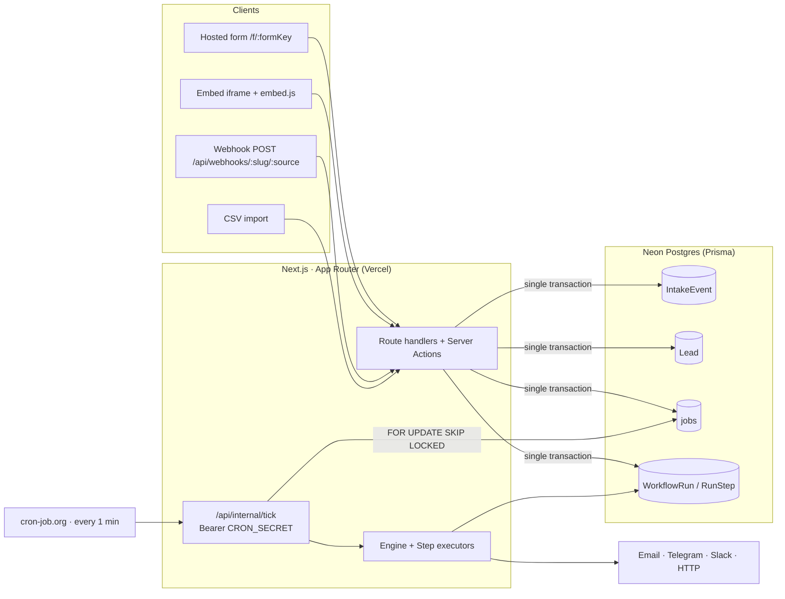

# FlowBridge — Lead-to-Action Workflow Automation

A lead arrives (form, webhook, or CSV) → it is persisted, assigned, the team is
notified, and a follow-up is scheduled — with a mini-CRM and a full run history.
Self-hosted, free-tier friendly, **no Redis, no always-on worker, no VPS**.

FlowBridge exists to eliminate silent automation failures: every run, step,
retry and error is visible, and a failed automation is never swallowed.

---

## Features (MVP)

- **Auth & workspaces** — email/password + Google OAuth, roles: Owner, Admin, Agent.
- **Intake**
  - Public hosted form at `/f/:formKey` and an embeddable snippet (`/embed.js` + iframe).
  - Generic webhook `POST /api/webhooks/:workspaceSlug/:source` with optional HMAC.
  - CSV import with column mapping, preview, dedupe, and a per-row import report.
  - Honeypot + per-IP/per-form rate limiting + payload caps on every public route.
- **Mini-CRM** — leads list with filters, detail page, status pipeline
  (New → Contacted → Qualified → Won/Lost), notes, and an interleaved activity + run timeline.
- **Workflow builder (form-based, no drag-and-drop canvas)** — Trigger → optional
  conditions (AND/OR groups) → ordered steps, with a live JSON preview and "Run on lead" test.
- **Steps** — assign (fixed / role / round-robin / rule-based), create task,
  update lead field, delay/wait, send email (Resend | SMTP | log-only),
  send Telegram, send Slack, HTTP request (outgoing webhook, SSRF-guarded).
- **Triggers** — `lead.created`, `lead.status_changed`, `lead.no_activity_for(minutes)`,
  `schedule(cron)`, `manual`.
- **Follow-up automation** — "if a lead is still `New` after a delay → notify + urgent task + escalate".
- **Tasks** — my tasks, due/overdue, complete.
- **Run history** — every run with per-step status, redacted inputs/outputs,
  durations, attempts, error, and one-click **retry from the failed step**.
- **Dashboard** — leads by source, avg first-response time, workflow success rate, overdue tasks.
- **Settings** — workspace name/slug, webhook secret rotation, member roles &
  availability, integration credentials (encrypted), API keys (create/revoke).
- **Seed data + demo workspace** — demoable golden path in under two minutes.

---

## Architecture



### The queue lives in Postgres

There is no Redis and no long-running worker. Work is modelled as rows in a
`jobs` table and processed by `/api/internal/tick`, called every minute by an
external cron.

1. **Intake** writes `IntakeEvent` + `Lead` + `WorkflowRun` + `jobs` rows inside
   **one transaction**, then returns `202`. It never performs outbound HTTP inline.
2. After the commit, a **best-effort in-process drain** runs the first jobs
   immediately, so the first steps usually execute in seconds (Next 14.0.4 has no
   stable `after()` — see `docs/decisions.md`).
3. The **cron tick** is the durable path. It runs on a ~25 second time budget,
   claims due jobs with `FOR UPDATE SKIP LOCKED`, reclaims jobs whose
   `lockedUntil` expired (crash recovery), and sets `runAfter` for retries/delays.

Because the tick runs once a minute, **delay steps and retries have ~1-minute
granularity**. This is intentional and documented, not a bug.

All queue access goes through the `JobQueue` interface, so the Postgres
implementation can be swapped for pg-boss/Inngest without touching callers.

---

## Tech stack

| Concern | Choice |
|---|---|
| Framework | Next.js 14 (App Router) + TypeScript (strict) |
| UI | Tailwind CSS + shadcn/ui + lucide-react, Recharts |
| DB | Neon Postgres + Prisma |
| Auth | NextAuth (Auth.js) v5 — credentials + Google |
| Jobs | Postgres `jobs` table + `/api/internal/tick` |
| Validation | Zod (shared client/server) |
| Forms | react-hook-form |
| Tests | Vitest (unit/integration), Playwright (E2E) |
| CI | GitHub Actions — lint, typecheck, test, coverage, `prisma validate` |

Repo layout (pnpm workspaces):

```
flowbridge/
  apps/web/            # Next.js app, route handlers, server actions
  packages/db/         # prisma schema, client, scoped helper, seed
  packages/core/       # pure: workflow zod schema, evaluator, templates, crypto, hmac, cron, ssrf
  docs/                # decisions.md, PHASES.md, design.md
```

---

## Getting started

**Prerequisites:** Node ≥ 20, pnpm 8, a Postgres database (Neon free tier works).

```bash
# 1. Install
pnpm install

# 2. Configure environment
cp .env.example .env        # then fill in the values (see below)

# 3. Create the schema and seed the demo workspace
pnpm db:generate
pnpm db:push                # or: pnpm db:migrate
pnpm db:seed

# 4. Run
pnpm dev                    # http://localhost:3000
```

### Environment variables

| Variable | Required | Notes |
|---|---|---|
| `DATABASE_URL` | ✅ | Postgres connection string (pooled URL for the app). Add `pgbouncer=true` when a transaction pooler sits in front (Neon/Supabase/PgBouncer) — the queue's raw claim query otherwise fails with `0A000`. |
| `NEXTAUTH_SECRET` | ✅ | ≥ 32 random chars. |
| `NEXTAUTH_URL` | ✅ | e.g. `http://localhost:3000`. |
| `ENCRYPTION_KEY` | ✅ | 32 bytes, base64. Encrypts integration secrets (AES-256-GCM). |
| `CRON_SECRET` | ✅ | Bearer token for `/api/internal/tick`. |
| `SMTP_HOST` / `SMTP_PORT` / `SMTP_USER` / `SMTP_PASSWORD` / `SMTP_FROM` | optional | Fallback when an email integration uses `smtp`. |
| `TELEGRAM_BOT_TOKEN` / `TELEGRAM_DEFAULT_CHAT_ID` | optional | Used by the seed's demo bot + as a fallback. |
| `GOOGLE_CLIENT_ID` / `GOOGLE_CLIENT_SECRET` | optional | Enables Google OAuth. |
| `NEXT_PUBLIC_APP_URL` | optional | Absolute URL used in embed snippets and lead links. |

Generate a valid `ENCRYPTION_KEY`:

```bash
node -e "console.log(require('crypto').randomBytes(32).toString('base64'))"
```

### Demo credentials (from `pnpm db:seed`)

| Role | Email | Password |
|---|---|---|
| Owner (Rafi) | `owner@demo.flowbridge` | `demo123` |
| Admin (Sam) | `admin@demo.flowbridge` | `demo123` |
| Agent (Nila) | `agent1@demo.flowbridge` | `demo123` |
| Agent (Kiran) | `agent2@demo.flowbridge` | `demo123` |

Seeded workspace slug: **`demo-agency`** · Seeded public form: **`/f/contact-form`**.

---

## Scheduling the tick

Point any scheduler at the tick route once a minute with the cron secret:

```bash
curl -X POST https://<your-app>/api/internal/tick \
  -H "Authorization: Bearer $CRON_SECRET"
```

- **cron-job.org** (free): create a job → URL as above → every 1 minute → add the
  `Authorization` header.
- **GitHub Actions** schedule (`*/1 * * * *`) is a fine free backup.
- Locally, just hit the endpoint (or let the in-process drain handle the first steps):

```bash
curl -X POST http://localhost:3000/api/internal/tick -H "Authorization: Bearer $CRON_SECRET"
```

---

## Intake endpoints

| Route | Purpose |
|---|---|
| `POST /api/intake/:formKey` | Public form submission (JSON or form-encoded; Zod generated from the form config). |
| `GET /f/:formKey` | Hosted public form page. |
| `GET /embed/:formKey` + `/embed.js` | Embeddable iframe + loader snippet. |
| `POST /api/webhooks/:workspaceSlug/:source` | Generic webhook intake. |
| `POST /api/leads/import` | CSV import (authenticated). |
| `POST /api/internal/tick` | Queue drain (Bearer `CRON_SECRET`). |

For webhooks, if `Workspace.webhookSecret` is set, requests must include a
`X-FlowBridge-Signature: sha256=<hex>` header (HMAC-SHA256 over the **raw body**,
constant-time compare). The secret is configured/rotated in **Settings → Workspace**.

---

## Testing

```bash
pnpm typecheck && pnpm lint && pnpm test     # required after every change
pnpm test:e2e                                # Playwright golden path
pnpm --filter @flowbridge/core test:coverage # coverage gate (≥70%)
```

- **Unit** (`packages/core`): condition evaluator, template renderer,
  workflow Zod schema, cron matcher, HMAC, redaction, crypto, **SSRF guard**.
  Coverage gate: **≥70%** statements/branches/functions/lines.
- **DB** (`packages/db`): `scoped()` cross-tenant isolation (fake delegate that
  actually applies `where`/`data`), demo-workflow schema drift.
- **Integration / E2E** need a real database; see `docs/` for the opt-in setup.
- **CI** runs lint → typecheck → test → core coverage → `prisma validate` on every
  push and PR (`.github/workflows/ci.yml`).

---

## Deployment

1. Create a Neon (or any) Postgres database; copy the connection string. If it is
   a **pooled** URL (Neon's `-pooler` host), append `&pgbouncer=true` — the
   job-claim query is a prepared statement and transaction poolers otherwise
   reject it with `cached plan must not change result type`.
2. Deploy `apps/web` to Vercel; set all required env vars.
3. Run `pnpm db:generate && pnpm db:push` (or `db:migrate:prod`) and `pnpm db:seed`
   against the production database.
4. Create the once-a-minute cron job (above) pointing at the deployed tick URL.
5. Optional: connect real integrations (Resend/SMTP, Telegram, Slack) in Settings.

---

## Known trade-offs

Stated honestly, per the project's own rules:

- **~1-minute granularity** for delay steps and retries (the tick runs each
  minute). Fine for lead handling.
- **Vercel Hobby is non-commercial.** Real client deployments must use the
  client's own hosting or a paid plan.
- **Resend free tier has a daily cap** — an SMTP fallback and a log-only mode are
  provided for demos.
- **Rate limiting is in-memory** (per-instance). Swap for Upstash/KV before
  relying on it across multiple instances.
- **`Lead.email` is globally unique** — dedupe is install-wide (single-tenant
  assumption; see `docs/decisions.md`).
- **No `after()` on Next 14.0.4** — the first drain is best-effort; the cron tick
  is the durable path.
- **Cron expressions are evaluated in UTC** (per-workflow timezones are deferred).

---

## Documentation

- [`docs/decisions.md`](docs/decisions.md) — assumptions and deliberate deviations.
- [`docs/PHASES.md`](docs/PHASES.md) — build order and current status.
- [`SPEC.md`](SPEC.md) — the contract (scope, data model, routes, UX, plan).
- [`AGENTS.md`](AGENTS.md) — engineering rules for contributors/agents.
